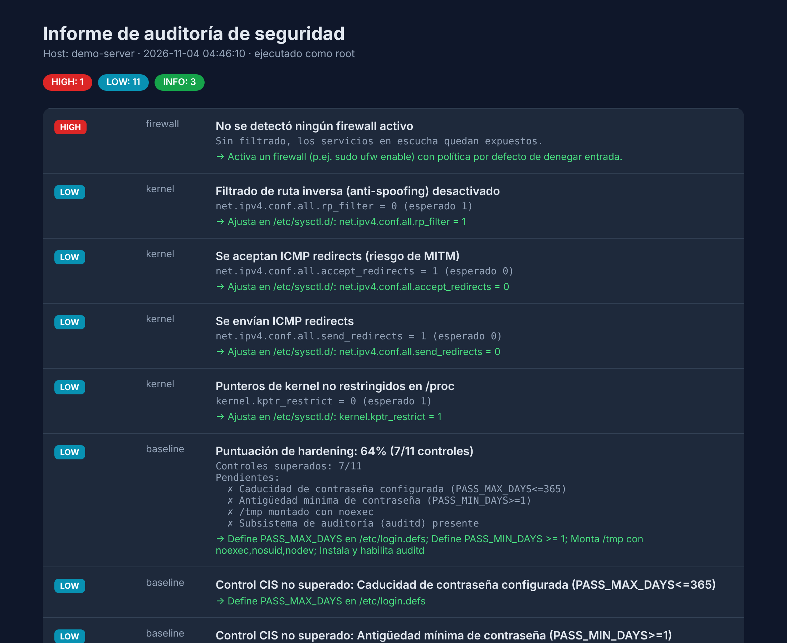

# secaudit

Auditor de seguridad defensiva para Linux con detección de cambios. Revisa 25 áreas de hardening, guarda una línea base del sistema y, desplegado como servicio de systemd, avisa cuando aparece algo nuevo: un binario SUID, un puerto expuesto, una regla de sudo o un binario del sistema alterado.

[](https://github.com/pablomtz-ti/secaudit/actions/workflows/ci.yml)




## Motivación

Herramientas como Lynis ofrecen una fotografía del sistema en un momento concreto. En un incidente, sin embargo, la pregunta relevante suele ser qué ha cambiado desde la última revisión: un binario SUID que apareció en `/usr/local/bin`, un servicio que empezó a escuchar en `0.0.0.0` o una línea `NOPASSWD` nueva en `sudoers.d`. secaudit combina la auditoría con una comparación contra una línea base conocida y se integra con systemd para vigilar el sistema de forma periódica.

## Características

- 25 módulos de comprobación de solo lectura, sin dependencias externas: solo la biblioteca estándar de Python.
- Detección de deriva (`--diff`): compara con una línea base y distingue entre hallazgos nuevos, elementos nuevos dentro de hallazgos existentes y problemas resueltos.
- Política de alertas: siempre se alerta de lo nuevo con severidad alta o crítica. En los módulos sensibles (`suid`, `caps`, `ports`, `keys`, `path`, `sudoers`, `cron`) también se alerta de cualquier elemento nuevo.
- Informes en consola, HTML, JSON, texto plano y Markdown.
- Despliegue como servicio con systemd:
  - temporizador semanal;
  - unidad endurecida con `ProtectSystem=strict` y `NoNewPrivileges`;
  - alertas opcionales por correo y rotación de informes.
- Ejecución en paralelo (`-j`) y códigos de salida pensados para integración continua y automatización.

| Área | Módulos |
|---|---|
| Cuentas y accesos | `users`, `accounts`, `sudoers`, `ssh`, `authlog`, `keys` |
| Red | `firewall`, `ports`, `kernel` (sysctl) |
| Escalada de privilegios | `suid`, `caps`, `path`, `permissions`, `sensitive`, `docker`, `cron` |
| Integridad y compromiso | `integrity` (dpkg/rpm), `rootkit` |
| Hardening tipo CIS | `baseline`, `mounts`, `modprobe`, `coredump`, `services`, `updates`, `system` |

La lista completa se obtiene con `secaudit --list`.

## Instalación

Como comando, con pip:

```bash
pip install git+https://github.com/pablomtz-ti/secaudit
```

O sin instalar nada, ya que es un único fichero:

```bash
git clone https://github.com/pablomtz-ti/secaudit
cd secaudit
python3 secaudit.py --help
```

## Uso

```bash
sudo secaudit                              # informe en consola
sudo secaudit --html informe.html          # informe HTML
sudo secaudit --only ssh,firewall,ports    # solo algunos módulos
sudo secaudit --min-severity MEDIUM        # oculta hallazgos menores

# Detección de cambios
sudo secaudit --json base.json             # 1. guarda la línea base
sudo secaudit --diff base.json             # 2. compara más adelante
```

Sin privilegios de administrador la herramienta funciona con cobertura parcial, y los módulos afectados lo indican.

| Código de salida | Significado |
|---|---|
| 0 | Sin hallazgos altos o críticos; en modo `--diff`, sin novedades relevantes |
| 1 | Hallazgos HIGH o CRITICAL; en modo `--diff`, novedades que requieren alerta |
| 2 | Error de uso o línea base no válida |

## Despliegue como servicio

```bash
sudo ./install.sh
```

El instalador copia la herramienta, crea la línea base inicial y activa un temporizador semanal. Después:

```bash
sudo systemctl start secaudit.service      # ejecutar ahora
journalctl -u secaudit -n 50 --no-pager    # ver el resultado
cat /var/lib/secaudit/LAST_ALERT.txt       # última alerta
sudo secaudit-baseline                     # aceptar cambios legítimos como nueva base
```

La línea base no se actualiza automáticamente, de forma deliberada: si se renovara en cada ejecución, una intrusión que avanza poco a poco pasaría desapercibida.

- La configuración (correo, módulos y retención de informes) está en `/etc/secaudit/secaudit.conf`.
- Para desinstalar, ejecuta `sudo ./uninstall.sh`.

## Decisiones de diseño

- Solo lectura: la herramienta nunca modifica el sistema. Recomienda el comando adecuado, pero no lo ejecuta.
- Sin `shell=True`: todos los comandos externos se lanzan como lista de argumentos y con tiempo límite.
- Tolerancia a fallos: si un módulo falla, el error se registra como hallazgo y el resto de la auditoría continúa.
- Configuración efectiva de SSH:
  - Con root se usa `sshd -T`.
  - Sin root, el analizador reproduce el comportamiento de sshd: prevalece la primera aparición de cada directiva, se siguen los `Include` y se descartan los bloques `Match`.
- Detección de módulos de kernel ocultos: se cruza `/sys/module` con `/proc/modules`. Comparar `lsmod` con `/proc/modules` no detecta nada, porque `lsmod` lee ese mismo fichero.
- Resultados estables entre ejecuciones: los puertos se identifican por servicio y no por PID, y los sockets UDP efímeros de aplicaciones cliente se excluyen. Así un reinicio no genera falsas alertas.
- La unidad de systemd está endurecida, pero no usa `PrivateTmp` ni oculta `/proc`, porque eso impediría las comprobaciones de rootkits y de procesos ocultos.

## Limitaciones

- Las heurísticas de rootkit son ligeras. Un rootkit de kernel competente puede engañar a cualquier herramienta que se ejecute dentro del propio sistema; para un análisis forense es necesario arrancar desde un medio externo.
- El módulo `integrity` depende de la base de datos de dpkg o rpm. Si un atacante la manipula, la comprobación pierde valor.
- Probado en Ubuntu 24.04. Debería funcionar en cualquier Debian o Ubuntu reciente. En RHEL y Fedora algunos módulos, como los de actualizaciones e integridad, tienen menor cobertura.

## Desarrollo

```bash
pip install -e . pytest ruff
pytest -q
ruff check --select E9,F secaudit.py tests
```

La integración continua ejecuta las pruebas en Python 3.10, 3.12 y 3.13, una prueba de humo del comando instalado, y ruff y shellcheck sobre el código.

## Uso responsable

Esta herramienta está pensada para auditar sistemas propios o sistemas para los que se tenga autorización explícita.

## Licencia

Distribuido bajo licencia [MIT](LICENSE).
